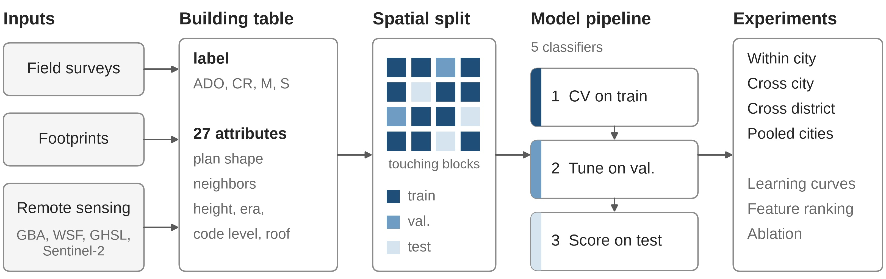
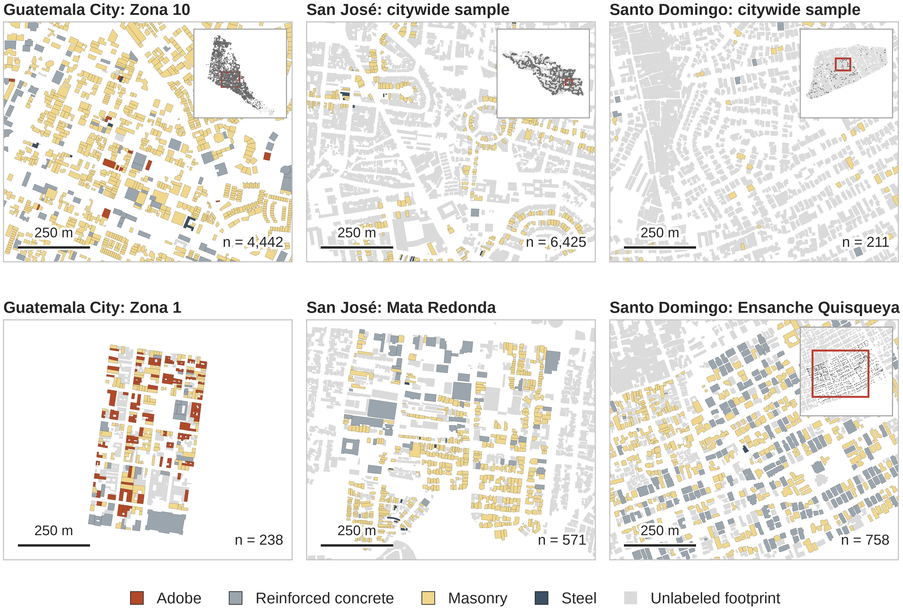
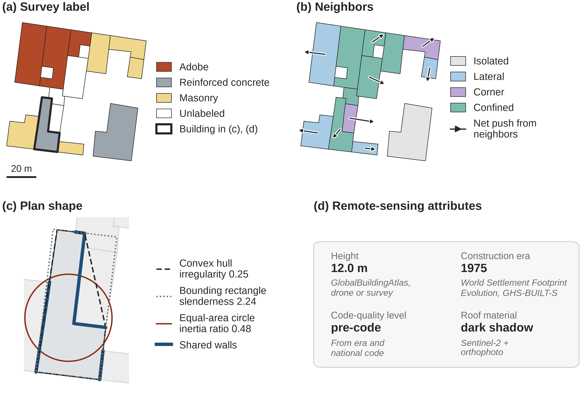
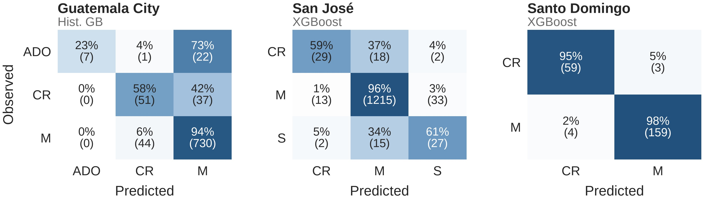
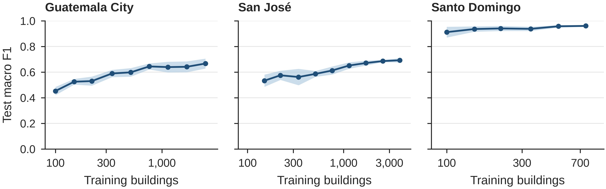
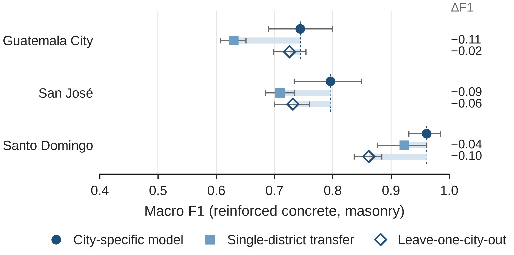
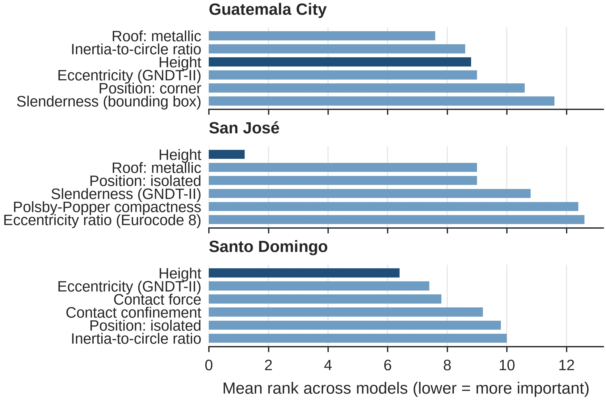

# How far can footprint data go? Inferring structural systems for seismic exposure models across three Latin American cities

Data and code to reproduce every table and figure of the paper. The models predict the structural system of individual buildings (adobe, reinforced concrete, masonry or steel) from the building footprint, its neighbors and a few low-cost attributes (height, construction era, code level and roof material). They are trained on field surveys from Guatemala City, San José (Costa Rica) and Santo Domingo (Dominican Republic) and evaluated within each city, across cities, across districts of the same city and as a single pooled model.

[](https://colab.research.google.com/github/GeomaticsCaminosUPM/ml_structural_system_paper/blob/main/paper_results.ipynb)

The method itself is the [`ml_structural_system`](https://github.com/GeomaticsCaminosUPM/ml_structural_system) package, installed here as a dependency at the exact version used for the paper. This repository holds only what is specific to the paper: the data, the experiment configurations, the analysis that turns the results into the paper's numbers, tables and figures, and the notebook. To apply the method to your own buildings, use the package directly.



## Contents

```
reproduce_paper.py      runs everything: python reproduce_paper.py
paper_results.ipynb     interactive walk-through with maps, ready for Google Colab
docs/map/               interactive 3D map of the buildings and predictions (GitHub Pages)
data/                   the six labeled surveys (GeoPackage)
experiments/            one folder per experiment with its config.yaml (main.yaml holds the shared settings),
                        plus the learning curve and the attribute ablation
analysis/               scripts that compute the reported numbers, figures and tables
```

## Data

Each file holds every building footprint of one survey area. Surveyed buildings carry their structural system in `survey_structural_system` and every model feature. The other footprints carry their geometry, `height`, `year`, `code_quality` and `roof_material`, enough for the interactive map to predict them (their footprint indices are computed with footprint_attributes).

| City | File | Survey | Labeled buildings |
|---|---|---|---|
| Guatemala City | `guatemala/zona10.gpkg` | Zona 10 | 4,442 |
| Guatemala City | `guatemala/zona1.gpkg` | Zona 1 | 238 |
| San José | `san_jose/san_jose_sample.gpkg` | citywide sample | 6,425 |
| San José | `san_jose/mata_redonda.gpkg` | Mata Redonda | 571 |
| Santo Domingo | `santo_domingo/santo_domingo_center.gpkg` | citywide sample | 211 |
| Santo Domingo | `santo_domingo/ensanche_quisquella.gpkg` | Ensanche Quisqueya | 758 |

Columns: `id`, `dataset` (file name), `city`, `block_id` (group of touching buildings), `survey_structural_system`, the 27 model features and `geometry`. The features are `height` (m), `year` (construction era), `code_quality`, `roof_material`, 18 plan-shape indices and 5 neighbor descriptors, computed with [footprint_attributes](https://github.com/GeomaticsCaminosUPM/footprint_attributes).

The survey codes are grouped into the four classes of the paper by `label_replacements` in `experiments/main.yaml`: ADO (adobe), CR (reinforced concrete, including steel frames), M (masonry) and S (steel, light steel), while I is dropped.





## Installation

You need Python 3.12 and [uv](https://docs.astral.sh/uv/).

```bash
git clone https://github.com/GeomaticsCaminosUPM/ml_structural_system_paper.git
cd ml_structural_system_paper
uv sync
source .venv/bin/activate
```

This installs the `ml_structural_system` package (with its `mlss` command) and every other dependency at the versions used for the paper. `requirements.txt` holds the same versions for `pip install -r requirements.txt`. Versions are pinned because even minor releases of scikit-learn, XGBoost or CatBoost can shift the scores slightly.

XGBoost and CatBoost train on the GPU when CUDA is available and on the CPU otherwise. Their standard wheels already include GPU support on Linux and Windows, so nothing else needs installing. Scores obtained on a CPU can differ slightly from the published ones, which were obtained on a GPU.

## Reproducing the paper

```bash
python reproduce_paper.py                                         # everything, several hours
python reproduce_paper.py figures tables                          # selected steps
python reproduce_paper.py experiments --experiments santo_domingo # selected experiments
```

| Step | What it does | Output |
|---|---|---|
| `experiments` | Splits, trains and tests the five models in each of the 13 experiments | `experiments/*/` |
| `learning_curve` | Learning curve of XGBoost in each city (Section 5.2) | `experiments/learning_curve_summary.csv` |
| `results` | Every number in the tables and text | `results/*.json` |
| `figures` | Figures 1 to 7 | `figures/*.jpg` |
| `tables` | Tables 1 to 4 | `results/tables/*.tex` |
| `map` | Data of the interactive map | `docs/map/data/` |

Every run trains the models from scratch: the `experiments` and `learning_curve` steps first delete the splits, models and reports of earlier runs. To continue an interrupted run instead, add `--resume`. Figures 1 to 3 and Table 1 only need the data, so `python reproduce_paper.py figures` draws them right after installation (Figures 4 to 7 need the earlier steps).

A run's outputs are meant to be committed, so the results can be reused without retraining. Git tracks, per experiment:

- the trained models (`trained_models/*/model_final_*.pkl`) and their tuned decision thresholds
- the encoders needed to apply the models
- the test split and its encoded version
- the `report/` folder with every building's test prediction

It also tracks the learning-curve tables, `results/` and `figures/`. Training by-products (the MLflow database, CatBoost logs, training and validation splits, per-repeat learning-curve models) are ignored. Any output over 30 MB is added to `.gitignore` at the end of each run.

The experiments are:

- `guatemala`, `san_jose`, `santo_domingo`: one model per city (Section 5.1).
- `loo_guatemala`, `loo_san_jose`, `loo_santo_domingo`: trained on two cities, tested on the third (Section 5.3).
- `zona1_to_zona10`, `mata_redonda_to_san_jose_sample`, `ensanche_quisquella_to_santo_domingo_center`: trained on one district, tested on the larger survey of the same city (Section 5.3).
- `all_cities`: one model for the three cities (Section 5.4).
- `guatemala_no_roof_code_year`, `san_jose_no_roof_code_year`, `santo_domingo_no_roof_code_year`: city models without roof material, code level and construction era (Section 5.5).

## Interactive map

[The structural system map](https://geomaticscaminosupm.github.io/ml_structural_system_paper/map/) shows every building of the six survey areas in 3D, with the structural system predicted by each city's models for every footprint, surveyed or not. Surveyed buildings are outlined, and the map can also color them by their surveyed class, by any model attribute (height, footprint area, construction era, code level, roof, position in the block, shape) or by a model's test predictions, errors and agreement. The test scores and confusion matrix of the selected experiment and model appear in a side panel. It is a static page in [docs/map/](docs/map/) (published with GitHub Pages from the docs/ folder), and `python reproduce_paper.py map` rebuilds its data from the experiment results (the footprint indices of the unsurveyed buildings take a while the first time and are then cached in `cache/`).

## Interactive notebook

[`paper_results.ipynb`](paper_results.ipynb) walks through the paper in a more interactive way:

- interactive folium maps of the six surveys, with each building's class and attributes
- feature distributions per class
- training of a chosen experiment from scratch, or of the full paper
- maps of the spatial split, the test predictions, the errors and the agreement between models
- confusion matrices and score tables
- the paper's Tables 2 to 4 and Figures 4 to 7 after a full run

Open it in [Google Colab](https://colab.research.google.com/github/GeomaticsCaminosUPM/ml_structural_system_paper/blob/main/paper_results.ipynb) with a GPU runtime: the first cell clones this repository and installs everything. To run it locally, use `uv sync --group notebook` and start Jupyter from the repository root.

## Results









## License

Code and data are released under the [European Union Public Licence v1.2](LICENSE) (EUPL-1.2). Background footprints come in part from Microsoft Building Footprints (ODbL).

## Citation

If you use this code or the data, please cite the paper. The full reference will be added here once it is published.
